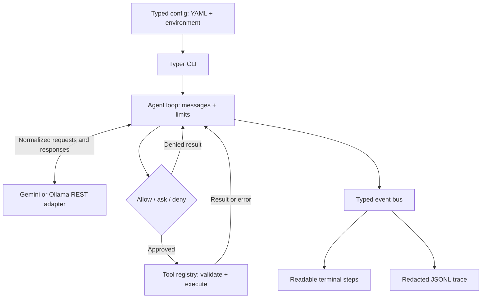

# Pilot

A local Python AI agent with tool calling, explicit permissions, and JSONL run traces.

[](https://github.com/sasmith-14/agent/actions/workflows/ci.yml)
[](pyproject.toml)
[](LICENSE)

<!-- DEMO GIF -->

## Architecture



## Quickstart

Requires Python 3.12 and [uv](https://docs.astral.sh/uv/getting-started/installation/).
From the project directory, install Pilot, create local config, and inspect its tools:

```sh
uv sync --locked --python 3.12
cp config.example.yaml config.yaml
uv run pilot tools
```

Listing tools makes no model API calls. To run a task, configure a provider below.
The `pilot` console command is installed from the `src/` package by `uv sync`.

## Features

- Gemini `generateContent` and Ollama `/api/chat` adapters using raw HTTP, without LLM SDKs.
- Three demo tools: `echo`, `get_time`, and a restricted arithmetic `calculator`.
- Pydantic argument validation, bounded tool output, and error results returned to the model.
- Sequential tool calls, per-tool `allow` / `ask` / `deny`, and interactive approval.
- Step and reported-token limits, with graceful limit results.
- Typed events and per-run JSONL traces tagged with run, agent, and parent IDs.
- YAML, `.env`, and environment configuration; masked config display and known-key redaction.
- Scripted `FakeProvider` and mocked HTTP tests for repeatable offline checks.

## Roadmap

| Phase | Scope | Status |
| --- | --- | --- |
| 1 | Foundation: loop, providers, tools, permissions, events, config, CLI | Done |
| 2 | Next permissioned capability; scope to be defined | Planned |
| Later phases | Research and laptop tools, learnable skills, planner/worker agents; order to be defined | Planned |

Only the foundation exists today. Live-provider acceptance remains a separate check.

## How this was built

Pilot uses spec-driven, AI-assisted development: work is scoped into phases with
explicit constraints and acceptance criteria. The owner designs the system,
reviews generated changes, and verifies behavior with tests and manual checks.
AI assistance supports implementation and learning; it does not replace that review.

See the [documentation](docs/), [architecture](docs/ARCHITECTURE.md),
[decision log](docs/DECISIONS.md), [verification notes](docs/VERIFICATION.md),
and [Phase 1 lesson](docs/learn/phase-1/lesson.pdf).

## Run a task

### Gemini

Create a key in [Google AI Studio](https://aistudio.google.com/apikey), run
`cp .env.example .env`, and set `GEMINI_API_KEY` there. Keep credentials out of YAML.
Set `gemini.model` in `config.yaml` to a model available to your account; the
model and base URL are configurable. API usage may incur provider charges.

```sh
uv run pilot run "What is 17*23 and what time is it?"
```

The default policy asks before each tool call. Approve `calculator` and `get_time`
when prompted; end-of-input denies approval. The final output includes usage and steps.

### Ollama

Install [Ollama](https://ollama.com/download), start its app or `ollama serve`, and
pull a tool-capable model matching `ollama.model` in `config.yaml`, for example:

```sh
ollama pull qwen3:8b
uv run pilot run "What is 17*23 and what time is it?" --provider ollama
```

For a permanent switch, set `provider: ollama` in config. Model suitability and
resource requirements depend on your machine.

## Configuration and policy

Precedence: CLI provider override, environment, `.env`, YAML, then defaults.
Inspect masked settings with `uv run pilot config show`; use `--config path/to/config.yaml`
to select another file. Relative paths resolve from the current working directory.
Nested overrides use `PILOT_` and `__`, for example `PILOT_LIMITS__MAX_STEPS=5`.

```yaml
policy:
  default: ask
  tools:
    calculator: allow
    get_time: deny
```

`allow` skips approval; `deny` blocks execution; `ask` requests a decision.
Risk labels describe tools; configured policies control access.
`max_steps` counts provider calls. Reported tokens are checked after a response,
before its tools execute, so one response can overshoot the token budget.

Run records live in `runs/<run_id>.jsonl`. They can contain task text and tool
results; known-key redaction is not a general personal-data scrubber.
Local config, credentials, traces, and build caches are ignored by Git.

## Development checks

After dependency installation, run the offline checks:

```sh
uv run --offline ruff check
uv run --offline ruff format --check
uv run --offline pytest -m "not live"
```

The default tests use scripted providers and mocked HTTP. Live smoke tests are
marked `live` and excluded from CI; passing offline tests does not verify a live
Gemini or Ollama round trip. CI installs dependencies before its offline checks.
See [CONTRIBUTING.md](CONTRIBUTING.md) for the contribution workflow.

## License

[MIT](LICENSE). The copyright holder is currently the requested `<YOUR NAME>` placeholder.
