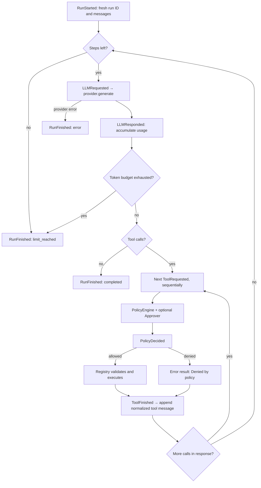

# Architecture

`config.py` validates configuration with Pydantic Settings, merging an isolated
YAML source under environment and dotenv sources. Secrets remain `SecretStr`
until the provider is constructed.

`providers/base.py` defines the only message, tool call, schema, usage, and
response types the agent sees. A factory selects Gemini or Ollama using config.
Each adapter receives an externally owned `httpx.Client`, handles its own wire
format, and uses the common bounded retry helper. FakeProvider owns a scripted
response sequence and snapshots requests for deterministic tests.

`tools/base.py` defines typed tools and results. The registry derives schemas,
rejects duplicate names, supports schema subsets, validates arguments, catches
execution exceptions, and truncates output at one boundary. Calculator parses a
small, resource-bounded arithmetic AST; it never evaluates Python code.

`permissions.py` resolves a per-tool override or default policy. Approvers make
only a yes/no decision. The agent emits the decision before executing a tool.
Risk is descriptive in Phase 1; only configured tool-name policies control access.

`events.py` contains seven typed event variants with UTC timestamps and
run/agent/parent IDs. The synchronous bus preserves emission order and gives
subscribers independent copies. TraceWriter appends a redacted JSON object per
line to a per-run file, opening and closing it for every event. Raw responses and
opaque adapter metadata never enter the trace. A trace-write failure propagates
so the next tool action cannot proceed without a record.

`Agent.run` owns all conversation, counters, and run IDs locally. Agent instances
receive their providers, registries, policy engines, buses, prompts, and limits.
Construct separate dependencies for separate agents; deliberately sharing a bus
means deliberately sharing its subscribers. `parent_id` is metadata only.

`cli.py` constructs its Typer app, console, client, policy, bus, trace sink, and
step view per invocation. Output comes from bus events; token streaming is not
implemented. Library callers explicitly subscribe TraceWriter when persistence
is needed. The caller owns client cleanup.
