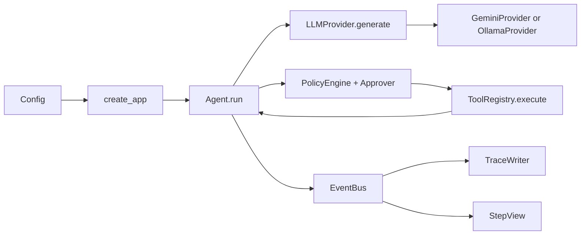

### 1. Big Picture (max 200 words)

Pilot is an **agent**: a program that asks a language model what to do, executes approved tools, and returns their results to the model. Phase 1 builds that control mechanism, with interchangeable **providers**, services answering model requests, plus argument checks, permissions, stopping limits, and a record of each run.

It currently offers only echo, arithmetic, and local time. It has no laptop automation, saved conversation memory, planner, or child agents. `parent_id` is only a label for future relationships (`src/pilot/agent/loop.py: Agent`).

The model proposes actions; Python decides whether and how to execute them. That distinction is the foundation for adding more powerful tools safely.

### 2. Concept Lessons

#### 1. Stateless model APIs and message roles

- **What it is:** A large language model (**LLM**) predicts responses from supplied **context**, the messages available for generation. An application programming interface (**API**) is a program's calling contract; **stateless** calls do not automatically remember earlier requests, so Pilot resends conversation messages.
- **Why it matters:** `system` carries standing instructions, `user` the task, `assistant` model responses, and `tool` execution results. Omitting earlier tool results leaves the next request without its evidence.
- **Real-world analogy:** Each call gives a consultant the case folder again.
- **Where it lives in our code:** `src/pilot/providers/base.py: Message`; `src/pilot/agent/loop.py: Agent.run`.
- **Industry note:** Server-managed conversations can move history storage elsewhere; they still require someone to own that history. Pilot owns it only during one run.
- **Interview angle:** Why resend messages? Each generation, one model-response request, needs its relevant context explicitly. Pilot accumulates messages within a run, but does not restore them on a later run.

#### 2. Tool calling separates proposals from execution

- **What it is:** A **tool call**, also called a function call, is a structured request naming a function and its arguments. It is data returned by the model, not Python execution.
- **Why it matters:** `ToolSpec` describes available tools; `ToolCall` contains a requested name, argument dictionary, and identifier. A **registry** maps tool names to implementations; the application checks permission before execution and links results through `tool_call_id`.
- **Real-world analogy:** An order ticket asks a kitchen to cook; the ticket cannot cook.
- **Where it lives in our code:** `src/pilot/providers/base.py: ToolSpec, ToolCall`; `src/pilot/tools/registry.py: ToolRegistry.execute`.
- **Industry note:** Restricting available tools reduces possible actions. Pilot can expose subsets through `ToolRegistry.specs(allowed_names)`; its current loop exposes every registered tool to the model.
- **Interview angle:** Does the model execute tools? No, it produces requests. Python remains responsible for permission, argument checks, execution, and reporting the result.

#### 3. The agent loop and stopping guardrails

- **What it is:** An **agent loop** repeats think → act → observe: request a model response, execute approved calls, then return observations. **Guardrails** are checks limiting what this repetition can consume or do.
- **Why it matters:** A plain response finishes the run; tool calls continue it. `max_steps` counts provider calls, excluding internal retry attempts; a **token**, a model's text-counting unit, contributes to accumulated input/output usage.
- **Real-world analogy:** A worker has both a task procedure and a spending allowance.
- **Where it lives in our code:** `src/pilot/agent/loop.py: Agent.run, RunResult`; `src/pilot/config.py: Limits`.
- **Industry note:** A strict spending ceiling needs additional estimation or generation constraints. Pilot checks reported usage after a response, so one response can exceed its token budget.
- **Interview angle:** What happens at the token limit? At usage greater than or equal to the limit, Pilot returns `limit_reached`. It executes none of that response's requested tools.

#### 4. Interfaces instead of vendor-specific logic

- **What it is:** An **interface** describes the behavior callers require. Python's `Protocol` expresses that contract without requiring implementations to inherit from one base class.
- **Why it matters:** The loop depends on `generate(messages, tools)` returning a normalized response: a shared representation independent of vendor formatting. An **adapter** translates between that representation and the provider's format.
- **Real-world analogy:** Different plugs work through adapters exposing the same socket.
- **Where it lives in our code:** `src/pilot/providers/base.py: LLMProvider, LLMResponse`; `src/pilot/providers/__init__.py: create_provider`.
- **Industry note:** A **factory**, a function selecting an implementation, centralizes provider choice. Shared interfaces simplify switching, but cannot erase every provider-specific capability.
- **Interview angle:** Why doesn't the loop inspect Gemini fields? That would couple orchestration to one vendor. Gemini and Ollama adapters translate those fields before the loop receives them.

#### 5. Dependency injection and isolated state

- **What it is:** A **dependency** is an object another object needs. **Dependency injection** means supplying those objects explicitly instead of constructing or finding them through shared global variables.
- **Why it matters:** **State** is information retained during execution; **global mutable state** is changeable information shared across instances through module-level objects. Pilot keeps conversation and counters inside `run`, and accepts its provider, tools, policy, bus, prompt, and limits explicitly.
- **Real-world analogy:** Two cooks receive separate ingredients and notebooks.
- **Where it lives in our code:** `src/pilot/agent/loop.py: Agent.__init__, Agent.run`; `src/pilot/cli.py: create_app`.
- **Industry note:** Automatic object assembly can reduce manual construction but hide wiring. Explicit construction makes ownership visible in this small application.
- **Interview angle:** Can two agents interfere? Separate dependencies avoid accidental shared runtime state. Deliberately passing the same bus or provider still deliberately shares that object's behavior.

#### 6. Pydantic validation and JSON Schema

- **What it is:** A **schema** describes allowed data; **validation** checks actual input against those rules. Pydantic supplies Python models for validation, while **JSON Schema** describes data shapes using JSON, a standard text format for structured values.
- **Why it matters:** Tool arguments are untrusted model output. `ToolArgs` rejects extra fields and uses strict types; invalid arguments become error results instead of crashing the loop.
- **Real-world analogy:** A form lists required boxes, and a clerk checks the completed form.
- **Where it lives in our code:** `src/pilot/tools/base.py: ToolArgs, Tool.spec`; `src/pilot/tools/registry.py: ToolRegistry.execute`.
- **Industry note:** One schema source avoids maintaining separate documentation and validation rules. Shape validation cannot establish that arithmetic is safe or a request is authorized.
- **Interview angle:** Do Python annotations validate dictionaries automatically? No; the registry explicitly calls `model_validate`. `Tool.spec` separately generates the schema shown to the model.

#### 7. Retries, backoff, jitter, and rate limits

- **What it is:** A **retry** repeats a failed request; a **rate limit** restricts request frequency. **Exponential backoff** increases the waiting interval between failures, and **jitter** adds randomness to that wait.
- **Why it matters:** HTTP, the request/response protocol used here, reports rate limiting with status `429` and server failures with `5xx`. Pilot retries those and timeouts, where a request exceeds its waiting allowance, without repeatedly retrying permanent errors.
- **Real-world analogy:** Call back later instead of redialing a busy office continuously.
- **Where it lives in our code:** `src/pilot/providers/retry.py: post_json, _retry_after`.
- **Industry note:** `Retry-After` is a server-provided waiting instruction. Shared request scheduling could coordinate several agents; Pilot only handles individual requests.
- **Interview angle:** Why add jitter? Identical retry schedules can produce another simultaneous burst. Randomized waits spread requests, while bounded attempts prevent endless retries.

#### 8. Permission policies and human approval

- **What it is:** A **policy** is a rule deciding whether an action is allowed. **Least privilege** means granting only necessary access; **human-in-the-loop** approval places a person at the decision point.
- **Why it matters:** Pilot resolves a per-tool setting or the default `ask`: `allow` skips the prompt, `ask` consults an approver, and `deny` blocks execution. A denied result returns to the model.
- **Real-world analogy:** A staff member needs approval before using a restricted service.
- **Where it lives in our code:** `src/pilot/permissions.py: PolicyEngine.decide, CliApprover.approve`; `src/pilot/agent/loop.py: Agent.run`.
- **Industry note:** Per-tool rules are simple; more powerful tools may need checks on arguments or destinations. Current risk labels are descriptive and do not enforce additional restrictions.
- **Interview angle:** Is default `ask` enough for least privilege? It prevents silent approval, but people can still approve unsuitable requests. Narrow tool access and appropriate argument policies remain necessary.

#### 9. Events and observability

- **What it is:** An **event** records something that happened; an **event bus** delivers events to registered **subscribers**, functions receiving them. **Observability** means understanding execution from its recorded outputs.
- **Why it matters:** The terminal view and trace writer consume the same events. A **trace** records a run's sequence; JSONL stores one JSON object per line, allowing inspection without parsing one giant document.
- **Real-world analogy:** A dispatcher sends the same incident report to a display and an archive.
- **Where it lives in our code:** `src/pilot/events.py: EventBus, TraceWriter`; `src/pilot/cli.py: StepView`.
- **Industry note:** An asynchronous bus delivers work separately; this synchronous bus calls subscribers immediately in order. It is simpler, but slow or failing subscribers affect execution.
- **Interview angle:** Why publish events instead of printing inside the loop? Events separate behavior from presentation and storage. Additional subscribers can observe runs without rewriting orchestration.

#### 10. Configuration and secrets

- **What it is:** **Configuration** supplies choices such as models, limits, and policies without changing source. A **secret** is sensitive information such as an API key; an **environment variable** supplies a named value to a running process.
- **Why it matters:** `load_config` prioritizes the explicit provider flag, environment, `.env`, YAML, then defaults. YAML is a readable settings format; `.env` holds environment-style assignments, including keys excluded from YAML.
- **Real-world analogy:** A machine has adjustable controls and a separately protected access key.
- **Where it lives in our code:** `src/pilot/config.py: Config, load_config`; `src/pilot/events.py: Redactor`.
- **Industry note:** A separate secret-management service can replace local files in deployment. Pydantic's `SecretStr` masks ordinary display; **redaction**, removing sensitive values from output, also happens before tracing.
- **Interview angle:** Does masking encrypt a key? No, masking changes presentation. The provider still receives the actual key, and arbitrary personal data is not automatically removed from logs.

#### 11. Fakes and deterministic tests

- **What it is:** A **test double** substitutes a controllable component for a real dependency. Pilot's **fake** provider returns scripted responses, making response sequences **deterministic**: repeatable rather than model-dependent.
- **Why it matters:** Tests can force invalid arguments, denials, or repeated calls without spending tokens or depending on network availability. FakeProvider also copies captured messages so later changes do not rewrite earlier evidence.
- **Real-world analogy:** A flight simulator produces chosen failures without risking an aircraft.
- **Where it lives in our code:** `src/pilot/providers/fake.py: FakeProvider`; `tests/test_agent.py: test_two_agents_and_repeated_runs_do_not_share_state`.
- **Industry note:** `httpx.MockTransport`, part of the HTTPX client library, substitutes HTTP responses while exercising the real adapters. These checks cannot prove that a live provider accepts a request or chooses appropriate tools.
- **Interview angle:** Why use both a fake and mocked HTTP? A fake tests loop decisions independently of vendor formatting. Mocked HTTP tests the adapter's translation while keeping requests offline.

#### 12. Python packaging and entry points

- **What it is:** **Packaging** makes Python code installable and importable as a package. A **src layout** places that package under `src/`; an **entry point** maps an installed terminal command to a Python callable.
- **Why it matters:** Setuptools, the **build backend** that prepares this package for installation, discovers Pilot under `src`. `pilot` invokes `pilot.cli:app`, a function creating a fresh command-line interface (**CLI**) using the Typer library.
- **Real-world analogy:** Packaging labels the product and provides its front-door button.
- **Where it lives in our code:** `pyproject.toml: [build-system], [tool.setuptools], [project.scripts]`; `src/pilot/cli.py: app, create_app`.
- **Industry note:** Keeping build requirements separate from runtime dependencies, libraries needed during execution, avoids making application code depend on its packaging tool. The test runner pytest finds code through `src`, so passing tests alone cannot prove installation.
- **Interview angle:** Does `pilot.cli:app` name a global application object? Here it names a function. That function constructs and invokes a new Typer application each time.

### 3. Guided Code Tour

1. **`src/pilot/agent/loop.py: Agent.run`.** Follow one plain answer and one tool response. Notice permission, validation, and stopping checks occur in different places.
2. **`src/pilot/providers/base.py: Message, LLMProvider`.** Read the shared vocabulary before vendor formats. Identify which fields describe conversation versus execution bookkeeping.
3. **`src/pilot/tools/registry.py: ToolRegistry.execute`.** Follow unknown names, invalid arguments, exceptions, and successful results. All return through bounded output handling.
4. **`src/pilot/tools/builtin.py: CalculatorTool.run, _evaluate`.** Distinguish structural argument validation from arithmetic restrictions. The parser accepts a small expression language, not arbitrary Python.
5. **`src/pilot/permissions.py: PolicyEngine.decide`.** Follow the per-tool override and default. Approval decides permission without itself running anything.
6. **`src/pilot/events.py: EventBus, TraceWriter`.** Compare event-specific fields with shared identifiers. Notice subscribers receive independent copies, and traces exclude preserved provider-only data.
7. **`src/pilot/config.py: load_config`.** Trace source precedence and validation failures. The locally created settings subclass keeps separate file loads independent.
8. **`src/pilot/cli.py: create_app`.** Find dependency construction and subscriber registration. The terminal displays events, while the loop remains usable without a terminal.

### 4. Trace Walkthrough

Use the existing offline scenario in `tests/test_cli.py: test_cli_with_real_adapter_and_mock_http`: “What is 17*23 and what time is it?” It exercises the real Ollama adapter with substituted HTTP responses and two approvals; it is not evidence of a live model run.

Every serialized event, converted to text, contains `type`, `timestamp`, `run_id`, `agent_id`, and `parent_id` (`src/pilot/events.py: BaseEvent` and subclasses). Timestamps use UTC, a shared reference time; this CLI uses agent `pilot` and parent `null`. Run and call identifiers are generated values, not fixed test constants.

| Order | Event type | Actual fields and behavior |
| --- | --- | --- |
| 1 | `run_started` | `task` contains the question. |
| 2 | `llm_requested` | `step=1`; `messages` contains system instructions and the user task; `tools` contains the three registered specifications. |
| 3 | `llm_responded` | Assistant `message.tool_calls` requests calculator with expression `17*23`, then get_time with empty arguments. `usage` is 10 input and 5 output tokens. |
| 4–6 | `tool_requested`, `policy_decided`, `tool_finished` | Calculator call, `risk=low`; `policy=ask`, `allowed=true`; `result.ok=true`, `result.output="391"`. |
| 7–9 | The same three tool event types | Get-time call; second approval; successful result containing the actual local date/time and offset. |
| 10 | `llm_requested` | `step=2`; history now includes the assistant's calls and two tool messages linked through `tool_call_id`. |
| 11 | `llm_responded` | The substituted answer is `391, now`, without calls; usage is 15 input and 3 output tokens. |
| 12 | `run_finished` | `status=completed`, `steps=2`, `final_text="391, now"`; total usage is 25 input plus 8 output tokens. |

Tool-message `content` is a string containing serialized `ToolResult`, including both `ok` and `output`, rather than an unwrapped result object. TraceWriter writes those structures as JSONL under `runs/<run_id>.jsonl`; it does not add a separate total-token field (`src/pilot/agent/loop.py: Agent.run`; `src/pilot/events.py: TraceWriter`).

### 5. Design Decisions & Trade-offs

These follow `docs/DECISIONS.md` and the current source:

1. **Raw REST versus an SDK.** REST is an API style using HTTP; Pilot calls endpoints directly. An SDK is a supplied client library. Adapters make translation visible; Pilot maintains formats and Gemini signature preservation itself (`src/pilot/providers/gemini.py: GeminiProvider.generate, _contents`).
2. **Sequential versus simultaneous tools.** One-at-a-time execution preserves obvious approval and result order. Independent slow tools cannot overlap (`src/pilot/agent/loop.py: Agent.run`).
3. **Ask versus allow by default.** Approval prevents silent execution. Repeated prompts cost attention and do not guarantee good human decisions (`src/pilot/permissions.py: PolicyEngine.decide`).
4. **Strict arguments versus automatic conversion.** `ToolArgs` rejects invented fields and mismatched types. Recoverable model mistakes require another exchange (`src/pilot/tools/registry.py: ToolRegistry.execute`).
5. **Observed usage versus predicted budgets.** Reported counts avoid invented estimates. One response can overshoot, and missing provider usage counts as zero (`src/pilot/agent/loop.py: Agent.run`; `src/pilot/providers/base.py: Usage`).
6. **Immediate file tracing versus separate delivery.** Trace failures stop subsequent actions. File writes slow the run and do not guarantee recovery after a machine crash (`src/pilot/events.py: EventBus.emit, TraceWriter.__call__`).

The decisions document's packaging-pending entry is historical: current `pyproject.toml` already configures setuptools and `pilot.cli:app`.

### 6. Common Failure Modes

1. **Endless tool requests:** `src/pilot/agent/loop.py: Agent.run` enforces step and reported-token limits. A single response may exceed the token allowance before it can be checked.
2. **Bad names or arguments:** `src/pilot/tools/registry.py: ToolRegistry.execute` returns errors for unknown tools and invalid inputs. Permission is checked first, even for unknown names.
3. **Request storms or outages:** `src/pilot/providers/retry.py: post_json` backs off for retryable failures. Ordinary connection failures stop immediately; there is no shared multi-agent rate controller.
4. **Prompt injection:** Untrusted tool text may try to redirect the model. `src/pilot/agent/prompts.py: DEFAULT_SYSTEM_PROMPT` tells it to treat results as data; that instruction is not enforced isolation. `src/pilot/tools/builtin.py: _evaluate` independently restricts calculator syntax.
5. **Secret leakage:** `src/pilot/events.py: Redactor` masks configured keys and credential patterns; raw provider bodies and `Message.provider_data` are excluded from events. Arbitrary sensitive personal information is not comprehensively scrubbed.
6. **Broken provider history:** `src/pilot/providers/gemini.py: GeminiProvider._contents` preserves response parts and signatures, extra provider data needed for some conversation continuations. Dropping them can invalidate later exchanges; signatures are excluded from traces.
7. **Cross-run contamination:** `src/pilot/agent/loop.py: Agent.run` creates fresh messages and counters. Injecting shared dependencies still creates intentional sharing; instance separation is not an automatic guarantee about every supplied object.
8. **Missing final records:** Trace-write errors propagate from `src/pilot/events.py: EventBus.emit`. Provider errors normally produce `RunFinished`, but failed storage cannot promise to record that final event (`src/pilot/agent/loop.py: Agent.run`).

### 7. Hands-on Exercises (5 total)

Run `export UV_OFFLINE=true` first. These exercises use existing commands and tests without provider calls.

1. **Goal: see configuration precedence.** Run `uv run pilot config show`, then repeat with `PILOT_LIMITS__MAX_STEPS=1` before the command. Observe the changed effective limit without editing YAML. **Concept:** environment overrides (`src/pilot/config.py: load_config`).
2. **Goal: inspect permission overrides.** Prefix `uv run pilot tools` with `PILOT_POLICY__TOOLS__CALCULATOR=deny`, then with the value `allow`. Observe only calculator's effective policy change; `ask` remains the default for other tools. **Concept:** per-tool access rules (`src/pilot/permissions.py: PolicyEngine.effective_policy`).
3. **Goal: examine invalid arguments.** Run `uv run pytest -v tests/test_agent.py::test_tool_errors_return_to_model`, then read that test. Observe three passing cases: unknown tool, missing text, and numeric text; each error reaches the next model request. **Concept:** validated boundaries and deterministic doubles.
4. **Goal: compare stopping limits.** Run `uv run pytest -v tests/test_agent.py -k 'max_steps or tokens_stop_before_tool_execution'`. Read the selected assertions: the step-limited case completes its tool batch, while token exhaustion prevents tools from that response. **Concept:** distinct stopping checkpoints (`src/pilot/agent/loop.py: Agent.run`).
5. **Goal: inspect a trace.** Run `uv run pytest -v tests/test_agent.py::test_tool_then_answer_and_all_trace_event_types --basetemp=/tmp/pilot-phase-1-lesson-traces`. Choose an unused directory: pytest clears its base directory. Open its generated `.jsonl` file and compare event order and identifiers with the test's `expected` list. **Concept:** structured observability; this single-tool example has nine records.

### 8. Self-Check Quiz

1. Why must Pilot send earlier tool results again?
2. What prevents a requested tool from immediately executing?
3. What happens when reported usage exactly equals the limit?
4. Does an invalid argument necessarily crash the run?
5. Why can switching providers leave the loop unchanged?
6. Could two injected agents still share state?
7. What if `Retry-After` exceeds `max_delay`?
8. Does a high risk label automatically deny access?
9. Does a passed offline adapter test prove live compatibility?
10. Why distinguish build requirements from runtime dependencies?

### 9. Glossary

- **Adapter:** Translation between a shared interface and an external format.
- **Agent:** Program coordinating model suggestions and application-controlled actions.
- **Agent loop:** Repeated generation, execution, and observation.
- **API:** Application programming interface; a program's calling contract.
- **Asynchronous:** Work delivered separately from the caller's immediate execution.
- **Backoff:** Increasing delay between retry attempts.
- **Build backend:** Tool preparing a Python package for installation.
- **CLI:** Command-line interface operated through terminal arguments.
- **Configuration:** Externally supplied operating settings.
- **Context:** Messages supplied to a particular model generation.
- **Dependency:** Component another component needs to operate.
- **Dependency injection:** Supplying required components explicitly.
- **Deterministic:** Producing a repeatable, controlled sequence of behavior.
- **Entry point:** Installed command's mapping to a Python callable.
- **Environment variable:** Named value available to a process.
- **Event:** Structured record of an execution occurrence.
- **Event bus:** Object delivering events to subscribed functions.
- **Exponential backoff:** Waiting intervals growing by repeated multiplication.
- **Factory:** Function selecting or constructing an implementation.
- **Fake:** Working substitute with deliberately simplified, controllable behavior.
- **Generation:** One request for a model response.
- **Global mutable state:** Changeable information shared through module-level objects.
- **Guardrail:** Enforced boundary on consumption or behavior.
- **HTTP:** Request/response protocol used for provider communication.
- **HTTPX:** HTTP client library used by provider adapters.
- **Human-in-the-loop:** A person participating in an execution decision.
- **Interface:** Required behavior exposed to callers.
- **Jitter:** Random variation added to retry delays.
- **JSON:** Text format representing structured values.
- **JSON Schema:** JSON description of permitted data structures.
- **JSONL:** Separate JSON objects stored one per line.
- **Least privilege:** Granting only the access needed.
- **LLM:** Large language model generating responses from context.
- **Message roles:** System instructions, user tasks, assistant responses, or tool results.
- **MockTransport:** HTTPX mechanism substituting responses for network requests.
- **Normalized:** Expressed in a shared internal representation.
- **Observability:** Understanding execution through its recorded outputs.
- **Packaging:** Preparing Python code for installation and import.
- **Policy:** Rule governing whether an action is permitted.
- **Prompt injection:** Untrusted content attempting to redirect model behavior.
- **Protocol:** Python declaration of expected object behavior.
- **Provider:** Service or implementation answering model-generation requests.
- **Pydantic:** Library creating validated Python data models.
- **pytest:** Runner for Pilot's tests.
- **Rate limit:** Restriction on request frequency or consumption.
- **Redaction:** Masking sensitive content before output or storage.
- **Registry:** Lookup table connecting tool names to implementations.
- **REST:** Style of API accessed here through direct HTTP requests.
- **Retry:** Another attempt after a failed request.
- **Retry-After:** Server instruction specifying how long to wait.
- **Runtime dependency:** Library needed when the application executes.
- **Schema:** Rules describing valid data shape and constraints.
- **SDK:** Supplied library simplifying calls to an external service.
- **Secret:** Sensitive value requiring restricted disclosure.
- **SecretStr:** Pydantic value type masking ordinary secret display.
- **Serialization:** Converting structured values into a storable text representation.
- **Setuptools:** Build backend preparing Python packages.
- **Signature:** Extra Gemini response data preserved across model turns.
- **Src layout:** Package sources placed under a separate `src/` directory.
- **State:** Information retained during execution.
- **Stateless:** Not automatically remembering previous requests.
- **Subscriber:** Function registered to receive events.
- **Synchronous:** Work completes directly before the caller continues.
- **Test double:** Controlled replacement for a real dependency.
- **Timeout:** Failure caused by exceeding a waiting allowance.
- **Token:** Unit used to count model input or output.
- **Tool call:** Structured request to execute a named tool.
- **Trace:** Recorded sequence describing a particular run.
- **Typer:** Library creating command-line interfaces.
- **UTC:** Shared reference time used for event timestamps.
- **uv:** Python package and environment manager.
- **Validation:** Checking supplied values against declared rules.
- **YAML:** Human-readable structured configuration format.

### 10. Preview of Next Phase

The next phase's exact scope is not defined here. A useful next step would be one narrowly permissioned capability built on the existing tool interface. It would require stronger rules about accepted inputs and external effects, plus tests for failures and denials. Saved conversation memory or planning would add new state and control problems; neither exists merely because this foundation exposes identifiers and interfaces.

### Answers (don't peek)

1. Each request needs its context explicitly; the application owns the conversation history.
2. Python checks policy, then validates arguments and executes the registered implementation.
3. The run returns `limit_reached` before executing that response's tools.
4. No: the registry returns an unsuccessful tool result that the model can respond to.
5. Adapters translate vendor formats into the same messages, calls, usage, and response contract.
6. Yes: deliberately sharing a bus or provider shares that supplied object's state and behavior.
7. Retry stops with `ProviderError` rather than waiting beyond the cap or retrying too soon.
8. No: only configured allow/ask/deny policies control permission in Phase 1.
9. No: substituted responses test local translation and control flow, not real provider acceptance or judgment.
10. Setuptools prepares installation; application libraries support execution. Separate declarations express those different requirements.
